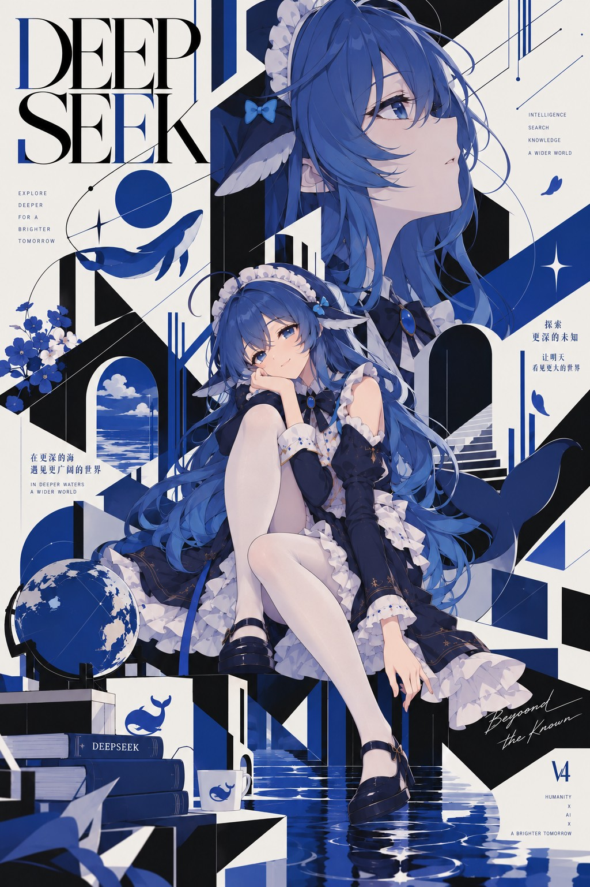
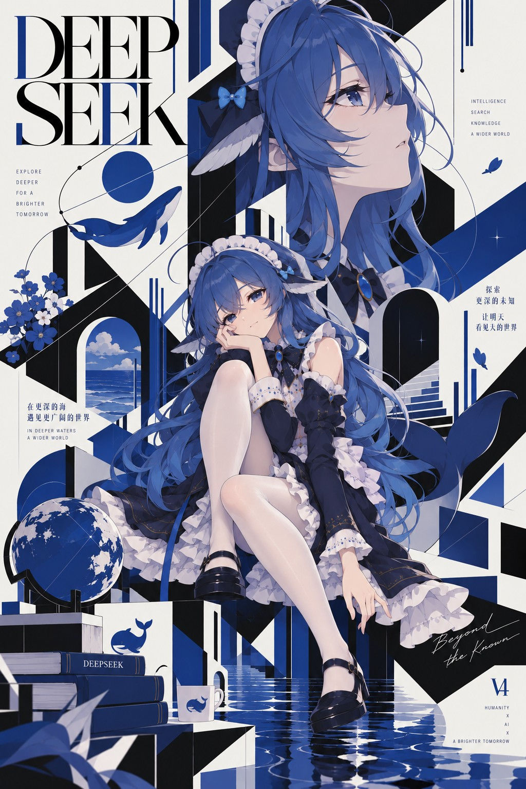
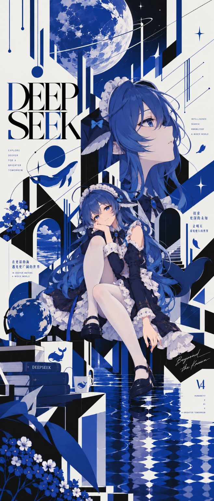
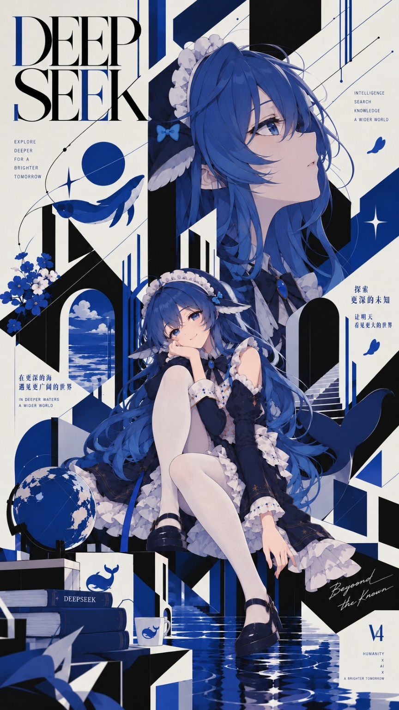
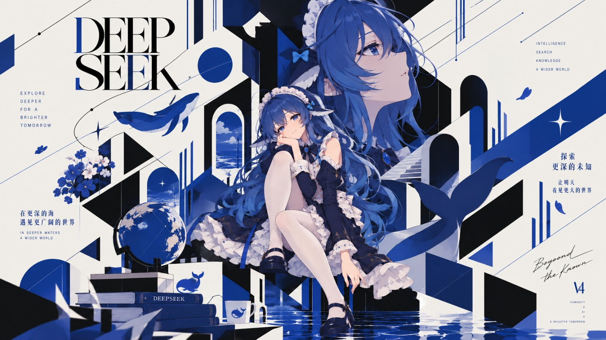

# Beyond the Known ｜ DeepSeek 拟人化构成主义海报

**作者 / Creator**：[-白_给-（Bilibili）](https://b23.tv/iCwTJiJ)  
**作品性质 / Type**：DeepSeek 主题非官方同人创作 · AI 拟人化 · 构成主义风格海报  
**创作方式 / Process**：AI 辅助图像创作；通过多轮迭代进行构图、配色、人物神态与细节的调整。

## 正式作品 / Final Artwork

**《Beyond the Known》** 的正式定稿为下方这一幅。它是本次投稿的**主作品与唯一正式版本**，其他四幅并非四件独立作品，而是同一视觉方案在创作过程中形成的**差分版本（variations）**。

[查看 / 下载正式作品 · 1024 × 1536](images/01-FINAL-poster.jpg)

## 创作概念 / Concept

以 DeepSeek 的蓝色鲸鱼意象及「探索未知」为主题线索，将拟人角色与海洋、窗景、建筑几何、图形线条和文字编排结合。蓝、白、黑三色形成统一的视觉语言；画面试图在人物叙事与构成主义式的几何秩序之间取得平衡。

Inspired by DeepSeek's blue-whale motif and the idea of exploring the unknown, this unofficial fan poster blends an anthropomorphic character with oceanic imagery, architectural geometry, graphic lines and editorial typography. A restrained blue, white and black palette brings the composition together.

## 差分版本 / Variations

下列四幅属于同一设计的**构图、画幅、局部细节及视觉组织方式的差分探索**。它们与正式定稿高度相似，保留在此仅用于展示创作过程及不同呈现方式，**不视为独立正式作品**。

The four images below are *variations* of the same design: alternative crops, compositions, layouts or detail-level iterations. They are included for context and are **not separate final artworks**.

| 文件 / Image | 角色 / Role | 尺寸 / Size |
| --- | --- | --- |
| **[01-FINAL-poster.jpg](images/01-FINAL-poster.jpg)** | **正式定稿 / Final artwork** | **1024 × 1536** |
| [02-variation-portrait.jpg](images/02-variation-portrait.jpg) | 竖版差分 A / Portrait variation A | 1024 × 1536 |
| [03-variation-extended.jpg](images/03-variation-extended.jpg) | 长幅差分 / Extended variation | 658 × 1536 |
| [04-variation-vertical.jpg](images/04-variation-vertical.jpg) | 竖版差分 B / Portrait variation B | 864 × 1536 |
| [05-variation-landscape.jpg](images/05-variation-landscape.jpg) | 横版差分 / Landscape variation | 1536 × 864 |

展开查看差分版本预览 / Show variation previews

**竖版差分 A / Portrait variation A**  

**长幅差分 / Extended variation**  

**竖版差分 B / Portrait variation B**  

**横版差分 / Landscape variation**  

五张图片均保留投稿者提供的原始文件，未重新裁切、改色、缩放或重新编码。  
All five submitted images are preserved byte-for-byte, without additional cropping, recoloring, resizing or recompression.

## 参考来源与声明 / References & Disclaimer

本作品以 DeepSeek 的名称、蓝色鲸鱼意象为主题参考，属于非官方粉丝二次创作；与 DeepSeek 及其运营主体不存在官方隶属、赞助或合作关系，不代表其官方立场。若作品另有具体的第三方参考素材或原作来源，发布时应补充对应署名。

This is unofficial fan art inspired by the DeepSeek name and blue-whale imagery. It is not affiliated with, sponsored by, or endorsed by DeepSeek or its operators. Any other identifiable source works should be credited where applicable.

## 授权说明 / Permission & Rights

**All Rights Reserved（在适用法律允许的范围内保留所有权利）。** 投稿者同意 AI-Fanworks 仓库为**非商业展示、存档和项目介绍**的目的托管并展示本次提交的作品；此许可不自动扩展为仓库外转载、商业使用、二次修改或再授权。如需上述其他用途，请先联系作者。

All rights reserved to the extent applicable under law. The creator permits the AI-Fanworks repository to host, archive and display these submitted works for non-commercial community exhibition and project description. This permission does not grant additional rights to redistribute the works outside the repository, use them commercially, modify them or sublicense them. Please contact the creator for any other use.

**发布前请向作者确认本节授权条款。 / Please confirm these terms with the creator before publishing.**
